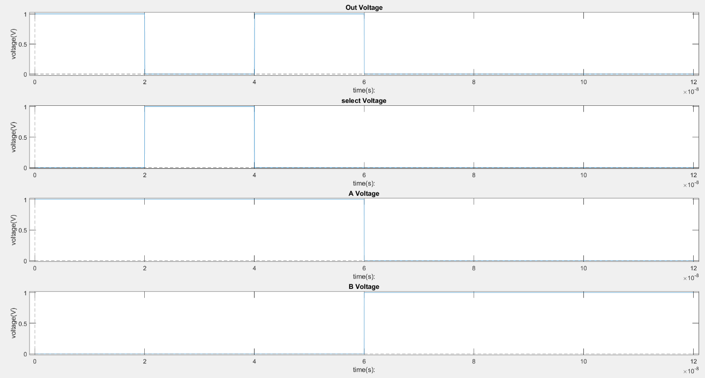
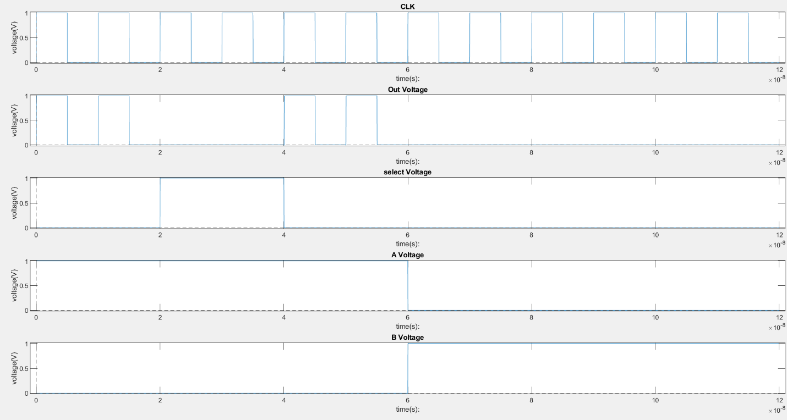
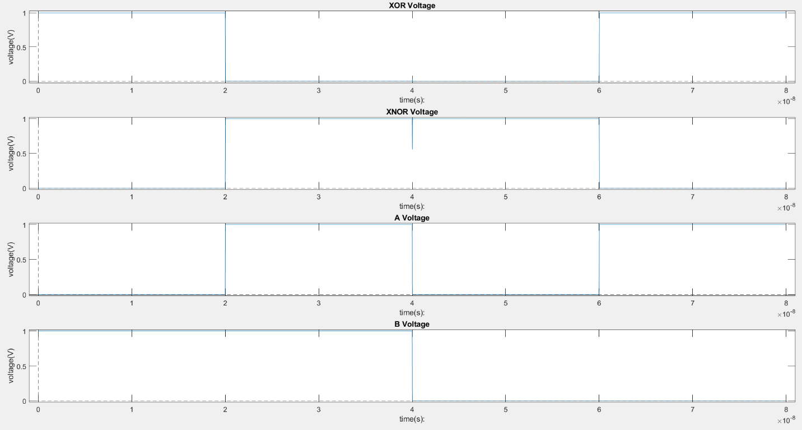
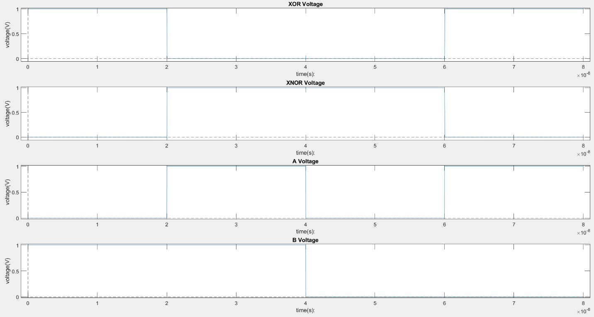

# CMOS Logic Style Comparison at 32 nm

HSPICE characterization of two logic functions implemented with four transistor-level circuit styles: a 2:1 multiplexer in static and dynamic CMOS, and complementary XOR/XNOR outputs in differential pass-transistor logic (DPL) and differential cascode voltage switch logic (DCVSL).

The study compares transistor count, selected propagation delays, and power averaged over specified time windows at 1 V. The dynamic MUX uses **10 MOSFETs versus 14** for the static MUX. DPL and DCVSL each use **12 MOSFETs**, including input-complement inverters. The archived selected delays are **8.079 ps / 23.02 ps** for static / dynamic MUX and **4.431 ps / 28.77 ps** for DPL / DCVSL.

## Engineering objective

Logic style changes the number of devices, switching behavior, and timing requirements of a circuit. This project examines those tradeoffs in two separate comparisons: static versus clocked dynamic selection, and pass-transistor versus regenerative differential logic.

The comparison is specific to the implemented circuits and input patterns. It does not establish minimum layout area, balanced rise/fall delay, or a universally superior logic style.

## Circuits and simulation conditions

The MUX implements `Y = A·S + B·S̅`: S = 1 selects A; S = 0 selects B. The dynamic implementation uses a precharged internal node, an NMOS evaluation network with a clocked footer, and an output inverter. During precharge, CLK = 0 and Y is driven low; the MUX function is evaluated when CLK = 1. Its output is therefore not a continuously valid replacement for the static MUX output.

Both differential implementations provide `out = A XOR B` and `out_bar = A XNOR B`.

| Circuit          |                           Core devices |                    Inverter devices | Total MOSFETs |
| ---------------- | -------------------------------------: | ----------------------------------: | ------------: |
| Static CMOS MUX  |                                      8 |          6: A, B, and S complements |            14 |
| Dynamic CMOS MUX | 6: 4 evaluation, 1 precharge, 1 footer | 4: S complement and output inverter |            10 |
| DPL XOR/XNOR     |                                      8 |              4: A and B complements |            12 |
| DCVSL XOR/XNOR   |     8: 6 NMOS and 2 cross-coupled PMOS |              4: A and B complements |            12 |

These are counts for the supplied implementations. They exclude clock-generation circuitry and are not layout-area measurements.

| Parameter                       | Value in the supplied files                           |
| ------------------------------- | ----------------------------------------------------- |
| Supply                          | 1 V                                                   |
| Gate length                     | 32 nm for all MOSFETs                                 |
| Core NMOS / PMOS width          | 32 / 64 nm                                            |
| Inverter NMOS / PMOS width      | 64 / 64 nm                                            |
| Model dependency                | `32nm_bulk.txt`, PTM bulk model, BSIM4 level 54       |
| Archived simulation temperature | 25 °C; not explicitly set in the decks                |
| Input transition duration       | 15 ps                                                 |
| Transient output interval       | 1 ps                                                  |
| Simulation duration             | MUX: 120 ns; XOR/XNOR: 80 ns                          |
| Dynamic clock                   | 10 ns period, nominal 5 ns high duration, 15 ps edges |
| External output capacitance     | None explicitly added                                 |
| Archived simulator              | HSPICE `P-2019.06-SP1-1 win64`                        |

## Multiplexer behavior



_Figure 1. Static MUX output, select, and data inputs. The select input stays near zero after 80 ns because the source uses a unitless `80+t` expression instead of `80n+t`; this plot is not evidence of complete input-state coverage._



_Figure 2. Dynamic MUX output, select, data inputs, and clock. Output-low precharge intervals are part of the clocked operation, not functional failures of a continuously evaluated MUX._

A and B are complementary throughout the MUX stimulus, so the A = B cases are not tested. The malformed select endpoint additionally prevents the intended select transition at 80 ns. The supplied waveform data confirm that S remains near zero at 82 ns and 102 ns. Functional evidence is therefore limited to the applied states and clock phases.

## XOR/XNOR behavior

The differential stimulus visits `(A,B) = 01, 11, 00, 10`. The archived data show complementary settled outputs for all four states:

| Sample time |   A |   B | `out` (XOR) | `out_bar` (XNOR) |
| ----------- | --: | --: | ----------: | ---------------: |
| 10 ns       |   0 |   1 |           1 |                0 |
| 22 ns       |   1 |   1 |           0 |                1 |
| 42 ns       |   0 |   0 |           0 |                1 |
| 62 ns       |   1 |   0 |           1 |                0 |

Logic levels above use a 0.5 V threshold on the archived samples. The actual voltages are retained in `results/sampled_waveforms.csv`. This settled-state check does not establish glitch-free operation during simultaneous input changes.



_Figure 3. DPL complementary outputs and input sequence. The XOR output begins high, falls near 20 ns, and rises near 60 ns._



_Figure 4. DCVSL complementary outputs and the same input sequence._

## Recorded measurements

The following values are taken from the supplied `.mt0` files. Original measurement names are retained in the power headings for traceability; they are not reliable descriptions of output state or transition direction.

| Circuit     | Selected delay (ps) | `out0avg` (nW) | `out0:1avg` (µW) | `out1:0avg` (µW) |
| ----------- | ------------------: | -------------: | ---------------: | ---------------: |
| Static MUX  |               8.079 |          84.48 |            11.70 |            13.79 |
| Dynamic MUX |               23.02 |          88.80 |            7.458 |            6.433 |
| DPL         |               4.431 |          92.78 |            16.58 |            17.97 |
| DCVSL       |               28.77 |          70.54 |            11.80 |            10.95 |

### Delay interpretation

All delay measurements use input and output crossings at 0.5 V, with `cross=1`. Each circuit records one selected event, not an average of rising and falling delays or an exhaustive worst-case path.

| Circuit     | Trigger       | Measured output event                                                 |
| ----------- | ------------- | --------------------------------------------------------------------- |
| Static MUX  | S after 20 ns | Output falling                                                        |
| Dynamic MUX | S after 40 ns | Output rising during evaluation; the clock changes near the same time |
| DPL / DCVSL | A after 20 ns | XOR output falling                                                    |

The dynamic MUX records a longer selected delay, but it is measured on a different edge and with a coincident clock event. This does not isolate intrinsic static-versus-dynamic path speed. DPL's selected XOR falling delay is about 6.49 times shorter than DCVSL's under the common stimulus; both output polarities and a specified load would need characterization before generalizing that result.

### Power windows and their limits

Every power value above is an `AVG power` measurement in HSPICE. No capacitive, leakage, or short-circuit component is separately extracted.

| Circuit     | `out0avg` window | `out0:1avg` window | `out1:0avg` window |
| ----------- | ---------------- | ------------------ | ------------------ |
| Static MUX  | 20.015–40 ns     | 40–40.015 ns       | 20–20.015 ns       |
| Dynamic MUX | 20.015–40 ns     | 40–40.015 ns       | 15–15.050 ns       |
| DPL / DCVSL | 0–20 ns          | 20–20.015 ns       | 60–60.015 ns       |

For DPL and DCVSL, `out` is **high** during 0–20 ns. The window labeled `out0:1avg` surrounds an XOR **fall**, while `out1:0avg` surrounds an XOR **rise**. The names would match the complementary output, but the delay target is `V(out)` and `power` is a circuit-level quantity.

For the dynamic MUX, the output-low window includes clock activity and is not a pure static-leakage measurement. Its falling-output window captures a precharge event, whereas the static MUX window captures a select-driven transition. The windows also have different durations: 50 ps versus 15 ps.

Some windows end before the output reaches its 50% crossing. For example, the dynamic MUX rising output reaches that crossing near 40.0305 ns, after its power window ends at 40.015 ns; DCVSL's measured crossing is near 20.0363 ns, also outside its 15 ps window. These averages cannot establish complete switching energy or a fair energy ranking. Input-source power accounting is particularly relevant to the DPL circuit because data inputs also drive pass-transistor terminals.

## Repository structure

| Path                                                | Contents                                                  |
| --------------------------------------------------- | --------------------------------------------------------- |
| `netlists/mux_static.sp`, `netlists/mux_dynamic.sp` | MUX experiment decks                                      |
| `netlists/xor_dpl.sp`, `netlists/xor_dcvsl.sp`      | Differential logic experiment decks                       |
| `results/reference/`                                | Original measurement files                                |
| `results/summary.csv`                               | Numeric summary from `.mt0` files                         |
| `results/waveforms/`                                | Losslessly compressed original waveform text exports      |
| `results/sampled_waveforms.csv`                     | Selected samples used for state and stimulus checks       |
| `docs/figures/`                                     | figures used above                                        |
| `docs/evidence/`                                    | images including edge details and schematic illustrations |
| `scripts/run.sh`                                    | Batch runner for local HSPICE                             |
| `runs/`                                             | Generated results, excluded from version control          |

## Run locally

Install HSPICE and place an authorized copy of the original `32nm_bulk.txt` in `models/`.

From the repository root:

```bash
bash scripts/run.sh
```

To run one circuit:

```bash
mkdir -p runs
cd netlists
hspice -i xor_dpl.sp -o ../runs/xor_dpl
```

The working directory must be `netlists/` for the relative include path. Review the generated listing warnings and compare the new measurements with `results/reference/`. Waveform exports can be unpacked using standard gzip tools; MUX columns are time, out, S, A, B, and differential columns are time, out, out_bar, A, B. The additional dynamic `data1` file contains time and clock.

## Reproducibility and next validation steps

Only deck titles and model paths were changed during packaging. The original electrical statements, malformed MUX time expressions, measurement names, and window boundaries were preserved. No fresh HSPICE execution was available during preparation.

A validated follow-up should correct the MUX timestamps, test all MUX states with suitable dynamic-clock timing, and measure both output edges under a common load. Power should be integrated over complete, comparable events with an explicit source-accounting boundary. The current work contains no layout extraction, process/temperature sweep, exhaustive timing test, or demonstrated area optimization.
